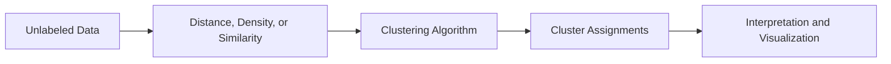

<div align="center">

# 🧩 Clustering Algorithms From Scratch

### Exploring Unsupervised Learning, One Algorithm at a Time

**군집화 알고리즘의 원리를 이해하기 위한 직접 구현·실험 프로젝트**

<p>
  
  
  
  
</p>

**[Repository](https://github.com/oyueo-mm/Clustering_Algorithms_From_Scratch)**

</div>

---

## 🔎 Overview

**Clustering Algorithms From Scratch**는 레이블이 없는 데이터를 어떻게 묶는지 이해하기 위해 군집화(clustering)의 수학적 원리와 알고리즘의 동작 과정을 탐구하는 프로젝트입니다.

이미 구현된 라이브러리의 결과만 확인하면서 라이브러리에 의존하는 것을 넘어서 거리와 유사도, 데이터의 분포, 군집 형성 규칙을 직접 만들어보면서 밑바닥부터 이해하는 데 초점을 둡니다.

> **Why from scratch?**  
> 군집화 결과뿐 아니라, 데이터가 실제로 어떤 기준에 따라 하나의 그룹으로 묶이는지를 이해하기 위해서입니다.

## 🧠 How Clustering Works

군집화는 정답 레이블이 주어지지 않은 데이터에서 구조나 패턴을 발견하는 **비지도 학습(Unsupervised Learning)** 방법입니다. 알고리즘에 따라 거리, 밀도, 계층적 병합, 유사도 등의 서로 다른 기준으로 군집을 구성할 수 있습니다.



## 🎯 Learning Objectives

- **Algorithmic understanding** — 군집이 형성되는 과정을 단계별로 이해
- **Mathematical intuition** — 거리·유사도와 최적화 기준의 의미 탐구
- **Implementation practice** — 알고리즘의 핵심 절차를 직접 코드로 표현
- **Behavior analysis** — 데이터의 분포와 매개변수에 따른 결과 차이 관찰
- **Trade-off awareness** — 알고리즘마다 다른 가정과 한계 이해

## 📐 Key Concepts

| Concept | Description |
|:--|:--|
| **Distance / Similarity** | 데이터 포인트 사이의 가까움이나 유사함을 정의하는 기준 |
| **Cluster Assignment** | 각 데이터가 어떤 그룹에 속하는지 결정하는 과정 |
| **Centroid** | 중심 기반 군집화에서 집단을 대표하는 위치 |
| **Density** | 밀도 기반 군집화에서 이웃 데이터의 집중 정도 |
| **Convergence** | 반복적인 군집화 과정이 안정화되는 조건 |
| **Outliers / Noise** | 어떤 군집에도 자연스럽게 포함되지 않을 수 있는 데이터 |

> 위 항목은 군집화의 일반적인 학습 개념입니다. 모든 군집화 알고리즘이 이 항목을 전부 사용하는 것은 아닙니다.

## 🧪 Questions Worth Exploring

밑은 군집화 알고리즘을 이해할 때 특히 살펴볼 질문들을 적어둔 리스트입니다.

1. 군집의 개수나 크기가 바뀌면 결과는 어떻게 달라질까?
2. 원형이 아닌 복잡한 모양의 데이터도 올바르게 구분할 수 있을까?
3. 노이즈와 이상치가 포함된 데이터에서는 어떤 현상이 나타날까?
4. 초기값이나 하이퍼파라미터의 변화에 결과가 얼마나 민감할까?
5. 알고리즘마다 계산 비용과 군집 형성 방식이 어떻게 다를까?

## 📂 Explore the Repository

저장소의 소스 코드와 실험 파일은 아래에서 확인할 수 있습니다.

**[View Source Code →](https://github.com/oyueo-mm/Clustering_Algorithms_From_Scratch)**

```bash
git clone https://github.com/oyueo-mm/Clustering_Algorithms_From_Scratch.git
cd Clustering_Algorithms_From_Scratch
```

각 구현의 실행 방법과 의존성은 해당 코드 파일의 내용을 기준으로 확인하세요.

## 📚 References

- [scikit-learn — Clustering](https://scikit-learn.org/stable/modules/clustering.html): 군집화 기법과 특징을 비교하기 위한 참고 자료
- [An Introduction to Statistical Learning](https://www.statlearning.com/): 비지도 학습의 통계적 배경 학습

---

<div align="center">

**Understanding algorithms by implementing them.**

Made by [oyueo-mm](https://github.com/oyueo-mm)

</div>
